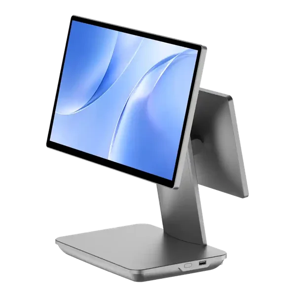
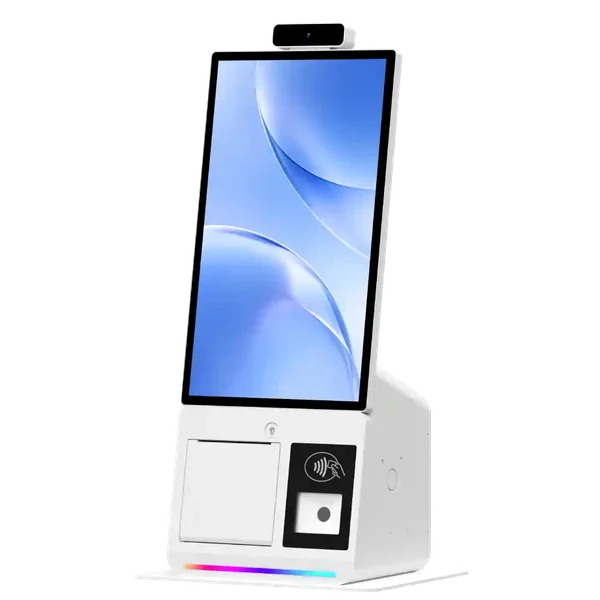
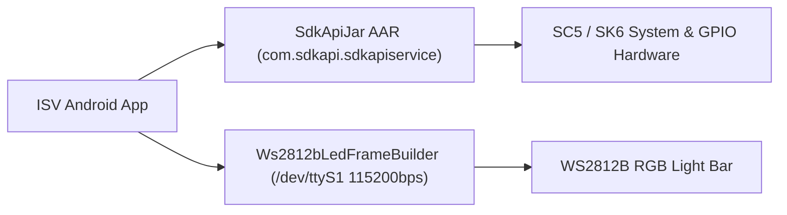

<div align="center">
  <a href="https://www.suntekai.com">
    <picture>
      <source media="(prefers-color-scheme: dark)" srcset="./assets/logo-dark.png">
      <source media="(prefers-color-scheme: light)" srcset="./assets/logo-light.png">
      
    </picture>
  </a>

  <h1>SUNTEK SC5 / SK6 Android System & LED Strip SDK</h1>

  <p>
    <strong>Official Hardware SDK &amp; Developer Kit</strong> &middot; <em>Enjoy Smarter Service</em><br>
    Shared Android system SDK and WS2812B serial LED controller specification for <strong>SC5</strong> (Desktop POS) and <strong>SK6</strong> (Self-Service Kiosk) terminals by <strong>SUNTEK Technology Co., Ltd.</strong>
  </p>

  <p>
    <a href="./LICENSE"></a>
    <a href="https://github.com/SUNTEK-Official/suntek-sdk-sc5-sk6/releases"></a>
    
    <a href="https://www.suntekai.com/products/suntek-desktop-pos-terminal-sc5/"></a>
    <a href="mailto:support@suntekai.com"></a>
  </p>

  <p>
    <a href="#hardware-showcase--compatibility">Hardware</a> &nbsp;&bull;&nbsp;
    <a href="#architecture--key-capabilities">Architecture</a> &nbsp;&bull;&nbsp;
    <a href="#supported-interfaces--physical-connections">Interfaces</a> &nbsp;&bull;&nbsp;
    <a href="#5-minute-quick-start">Quick Start</a> &nbsp;&bull;&nbsp;
    <a href="#sample-apps--prebuilt-downloads">Downloads</a> &nbsp;&bull;&nbsp;
    <a href="#troubleshooting--faq">FAQ</a> &nbsp;&bull;&nbsp;
    <a href="#documentation-changelog--support">Support</a>
  </p>
  
</div>

---

## Hardware Showcase & Compatibility

<table>
  <tr>
    <td align="center" width="50%">
      <a href="https://www.suntekai.com/products/suntek-desktop-pos-terminal-sc5/">
        
      </a>
      <br>
      <strong>SC5</strong><br>
      <sub>Dual-Screen Android POS (GMS)</sub><br>
      <a href="https://www.suntekai.com/products/suntek-desktop-pos-terminal-sc5/">Official Product Page</a>
    </td>
    <td align="center" width="50%">
      <a href="https://www.suntekai.com/products/compact-self-service-kiosk-sk6/">
        
      </a>
      <br>
      <strong>SK6</strong><br>
      <sub>Compact Self-Service Kiosk</sub><br>
      <a href="https://www.suntekai.com/products/compact-self-service-kiosk-sk6/">Official Product Page</a>
    </td>
  </tr>
</table>

| Product Model | Chipset / Board | OS Versions | Build Identifier | Status |
| :--- | :--- | :--- | :--- | :---: |
| **SC5** | Embedded ARM Platform | Android 11 - 14 | `SC5*` | Supported |
| **SK6** | Embedded ARM Platform | Android 11 - 14 | `SK6*` | Supported |

> [!IMPORTANT]
> Verify your device **Model** and **Build Number** under Android **Settings -> About device** before integration. Customer applications use your own Google Play or enterprise release certificate.

---

## Architecture & Key Capabilities

- **Shared SC5 & SK6 Board Architecture**: Unified `SdkApiJar` AAR API plus direct serial RGB LED bar protocol.
- **WS2812B Status Light Control**: Ready-to-use `Ws2812bLedFrameBuilder` generating UART packets on `/dev/ttyS1` (`115200 bps, 8N1`).
- **Standard GMS/Enterprise Signing**: Communicates directly with preinstalled `com.sdkapi.sdkapiservice`.



---

## Supported Interfaces & Physical Connections

| Hardware Feature | Interface Type | Device Path / Service Target | Notes |
| :--- | :--- | :--- | :--- |
| **Preinstalled System IPC** | Binder Service (`com.sdkapi`) | `com.sdkapi.sdkapiservice` | Device info, display, GPIO, silent install |
| **LED Light Strip** | UART Serial (WS2812B / STC8G1K08A) | `/dev/ttyS1 @ 115200 bps (8N1)` | Protocol doc & sample helper included |

---

## Repository Directory Layout

```text
suntek-sdk-sc5-sk6/
├── assets/                 # Official SUNTEK logos, hero banner & SC5/SK6 photos
├── sdk/
│   └── SdkApiJar_V1.250915.0914.aar
├── docs/
│   ├── SdkApi-Guidance-EN.pdf
│   └── ws2812b-led-serial-protocol.md
├── sample-android/         # Android sample with Ws2812bLedFrameBuilder
├── README.md
├── LICENSE
├── THIRD_PARTY_NOTICES.md
└── CHANGELOG.md
```

> All installers (`.exe`), compiled sample APKs (`.apk`), and large binary packages (> 5 MB) are hosted on [**GitHub Releases**](https://github.com/SUNTEK-Official/suntek-sdk-sc5-sk6/releases) with `SHA256SUMS.txt`.

---

## Prerequisites & Permissions

- **Platform Target**: `minSdk 24` / `targetSdk 35`
- **App Signing Requirement**: Use your standard Google Play or enterprise release key (IPC via `com.sdkapi.sdkapiservice`).
- **Required Permissions / Capabilities**: `INTERNET`, serial UART device access on `/dev/ttyS1`.

---

## 5-Minute Quick Start

### Step 1: Add Dependency

```gradle
dependencies {
    implementation files('libs/SdkApiJar_V1.250915.0914.aar')
}
```

### Step 2: Query Device Info & Drive WS2812B LED Strip

```java
import com.sdkapi.api.SdkApi;
import com.suntek.sample.sc5sk6.Ws2812bLedFrameBuilder;

SdkApi.newInstance(getApplicationContext());
String sn = SdkApi.getInstance().DeviceInfo().getSerialNumber();

// Build static green LED frame (R, G, B, brightness) for /dev/ttyS1 at 115200 bps
byte[] ledFrame = Ws2812bLedFrameBuilder.buildStaticColorFrame(0x00, 0xFF, 0x40, 0xFF);
```

### Build & Run Sample Project

```bash
cd sample-android && ./gradlew assembleDebug
```

---

## Sample Apps & Prebuilt Downloads

Verified prebuilt APKs, offline SDK bundles, and checksum manifests are published on [**GitHub Releases**](https://github.com/SUNTEK-Official/suntek-sdk-sc5-sk6/releases). Verify downloaded archives before production deployment:

```bash
shasum -a 256 -c SHA256SUMS.txt
```

---

## Troubleshooting & FAQ

<details>
<summary><b>Does this repository support both SC5 and SK6?</b></summary>
<p>Yes. SC5 and SK6 share the identical underlying `SdkApiJar` AAR and serial peripheral mapping.</p>
</details>

<details>
<summary><b>What baud rate does the WS2812B LED controller use?</b></summary>
<p>`/dev/ttyS1` at `115200 bps`, 8 data bits, no parity, 1 stop bit (`8N1`). See `docs/ws2812b-led-serial-protocol.md`.</p>
</details>

<details>
<summary><b>Can I test both system APIs and LED light bars in one app?</b></summary>
<p>Yes, `sample-android/` initializes `SdkApi` and bundles `Ws2812bLedFrameBuilder.java`.</p>
</details>

---

## Documentation, Changelog & Support

- **Changelog**: [CHANGELOG.md](./CHANGELOG.md)
- **Developer Documentation Portal**: [suntek-docs](https://github.com/SUNTEK-Official/suntek-docs)
- **Technical Support**: [support@suntekai.com](mailto:support@suntekai.com)
- **Bug Reports**: [Open an Issue](https://github.com/SUNTEK-Official/.github/issues/new/choose)
- **Security Disclosures**: See [SECURITY.md](https://github.com/SUNTEK-Official/.github/blob/main/SECURITY.md) or email [support@suntekai.com](mailto:support@suntekai.com)

---

<div align="center">
  
  <br><br>
  <strong>SUNTEK Technology Co., Ltd.</strong> &mdash; <em>Smart Commercial Terminal Hardware Manufacturer Since 2010</em><br>
  <sub>80+ Export Countries &middot; 5,000,000+ Terminals Shipped &middot; 500+ ODM Projects &middot; ISO 9001 / ISO 14001 / ISO 27001 / CE / RoHS</sub><br>
  <sub><a href="https://www.suntekai.com">www.suntekai.com</a> &middot; Copyright &copy; 2026 SUNTEK Technology Co., Ltd. All rights reserved.</sub>
</div>
